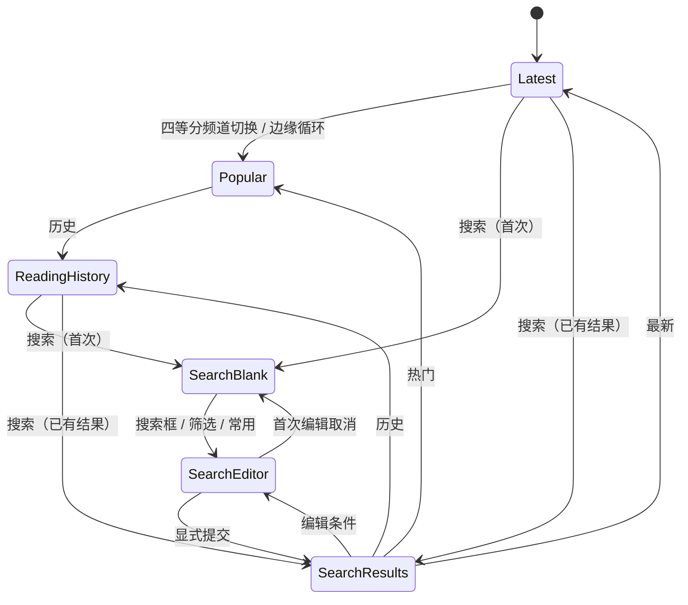
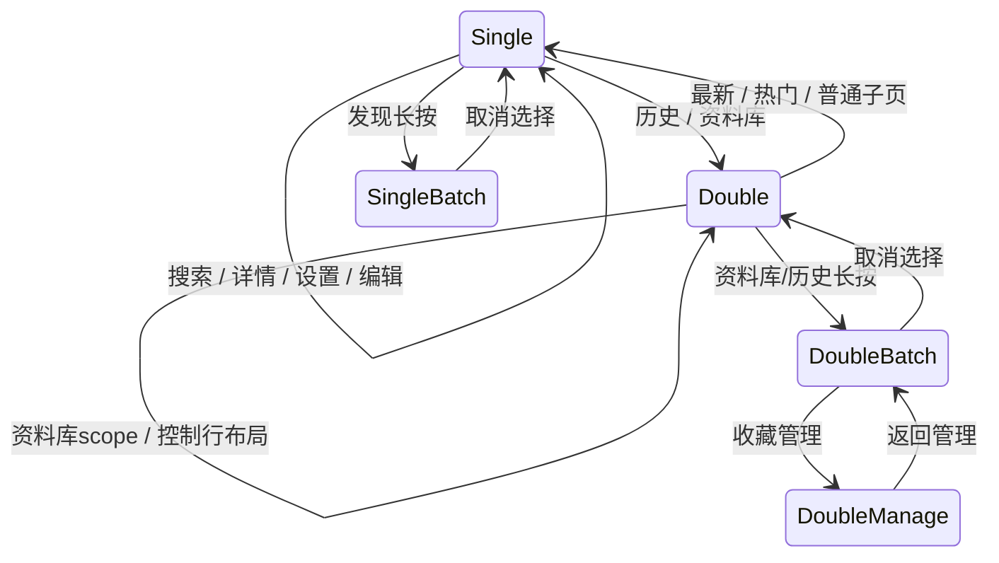
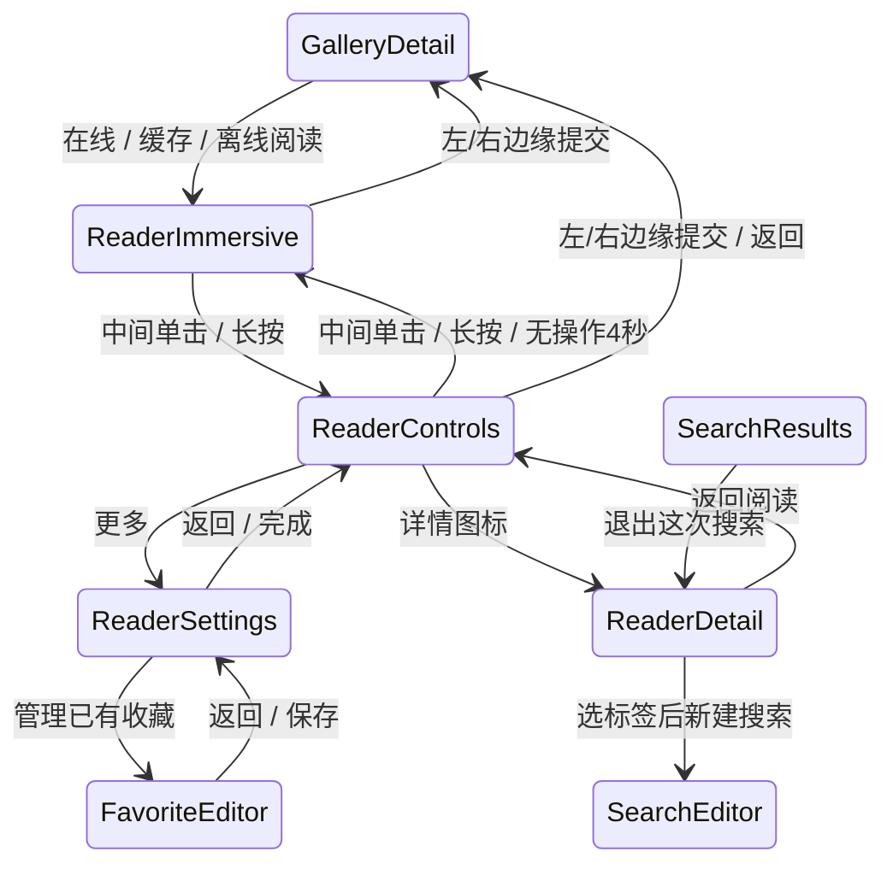

# ExViewer 页面与 Chrome 状态图（131）

本清单是生产源码的语义路由盘点，不是运行覆盖率。根宿主绘制一份顶栏外框和一份底栏外框；页面只提交栏内内容。普通单行命中行44pt/可见面34pt，双行两条44pt命中行；可见面之间及外框内距4pt，控件R8、外框R12。字体沿既有共享规则。

## 导航与搜索

131按用户纠正：第一行固定四等分「最新／热门／历史／搜索」，搜索是频道而非小按钮。最新与热门只显示第一行；历史和搜索展开第二行。搜索首次进入不提交请求、下方留空，第二行为搜索框（含筛选，3/4宽）与常用（1/4宽）。提交后在搜索频道显示结果，切回时复用对应entry与滚动锚点；边缘拖动预览也复用已有结果，首次才为空。

普通发现搜索沿用根 `DiscoveryNavigation` 和详情target，恢复搜索使用 `submit` 而非 `execute`，避免频道切换重复写搜索记录。根页不暴露混入频道浏览的历史返回，改由四频道切换。详情发起的新搜索仍为独立 `GallerySearchFlow`；其结果保留单行搜索栏，退出回原详情。所有搜索编辑均使用现有宿主内完整页，半成品草稿在记录/标签子页往返保留。130的「三频道加小搜索按钮」被本节取代。

## 栏模板

- 单→双与双→单：根外框顶边/左右边固定，真实高度从当前呈现高度转向目标，下沿伸缩，内容交接；不是两份外框叠放加遮罩。
- 单→单与双→双：外框身份保留，稳定位置的控件不整栏平移。选择块继续跟手；需要重新分配空间的控制行按目标轨道布局交接。
- 详情独立搜索返回槽：0↔38pt（34pt方钮+4pt间隔），搜索框右边缘和常用列固定，文字保持字号与单行省略；出场控件不再可点。
- 时间集中在 `ChromeMotion`：结构240ms，内容160ms，局部控件180ms。结构与内容变化可以重叠，几何由SwiftUI当前呈现值转向新目标，没有页面各自延迟任务。
- 主底栏↔批量栏：同一底栏外框、位置和标准行高，内部操作交接；分类/排序等菜单不改整栏尺寸。
- 减弱动态效果：不做几何补间，直接目标布局；所有交互/页面仍可达。

## 阅读流

阅读器进入/退出为独立全屏过渡，图片翻页/缩放和普通栏切换分开管理。中心双击无操作；边缘双击缩放保留。完整设置/详情显示时Reader实例与媒体缓存保持挂载，底层阅读控件不参与命中或辅助功能；子页恢复主tab栏。设置不再是sheet。逐级返回顺序为收藏编辑→设置→Reader。缩放、菜单、页面覆盖、旋转与后台状态会取消或暂停相关拖动。

## 页面覆盖矩阵

| 页面或同页子状态 | 顶栏 | 底栏 | 呈现/返回 |
|---|---|---|---|
| 最新、热门、未登录浏览入口 | 单行四等分频道 | 主tab | 频道内更新 |
| 发现阅读历史；检索、时间、排序 | 双行 | 主tab | 原频道内切换 |
| 发现长按选择 | 单行选择头 | 批量 | 取消回原列表 |
| 资料库稍后再读；过滤/排序 | 双行 | 主tab/批量 | scope内切换 |
| 站点收藏；分组/排序 | 双行 | 主tab/批量/收藏管理 | 管理可逐级返回 |
| 资料库阅读历史；检索/排序 | 双行 | 主tab/批量 | 复用历史内容 |
| 离线下载；过滤/排序/暂停/继续/失败 | 双行 | 主tab/移除批量 | 完整副本直接读缓存 |
| 我的根页 | 单行 | 主tab | push各子页 |
| 登录管理、官方登录/EX验证 | 单行 | 主tab | 业务整页push |
| 标签与屏蔽；独立scope检索/选择 | 单行 | 主tab | 搜索条和结果/已有列表同页 |
| 收藏设置；默认分组/行内改名 | 单行 | 主tab | 改名不新增页面 |
| 收藏同步；queued/syncing/uncertain/failed/login | 单行 | 主tab | 检查/重试为同页状态 |
| 阅读与存储；拉条/开关/统计/清理 | 单行 | 主tab | 精确数字输入小alert |
| 看图额度；loading/error/unavailable | 单行 | 主tab | 官方额度Link离开App |
| 赞助与权益；loading/error/已有权益 | 单行 | 主tab | 官方Link离开App |
| 根搜索频道；空白/结果/记忆恢复 | 双行四频道+搜索/常用 | 主tab/批量 | 同一发现导航内缓存切换 |
| 普通搜索编辑；筛选折叠/展开/清空 | 单行 | 主tab | 独立搜索流程 |
| 常用组合；载入/排序/编辑 | 单行 | 主tab | 同流程分支/整页子编辑 |
| 搜索历史；载入/滑删/另存 | 单行 | 主tab | 整页push，返回保留半成品 |
| 保存搜索组合 | 单行 | 主tab | 保存/取消回草稿 |
| 添加标签；查询/namespace/匹配/已选/常用/词库 | 单行 | 主tab | 整页push |
| 已保存组合编辑；改名/条件/删除 | 单行 | 主tab | 保存后返回原列表 |
| 详情独立搜索结果；返回/前进/筛选/常用 | 单行 | 主tab/批量 | 独立navigation，退出回来源 |
| 普通画廊详情；标签多选 | 单行 | 主tab | push，更多为菜单 |
| 下载方式；本地缓存/更新/BT | 单行 | 主tab | 整页push |
| BT种子列表；取文件/失败/重试 | 单行 | 主tab | 系统分享例外 |
| 站点收藏编辑；分组/同步状态/移除 | 单行 | 主tab | 普通push/Reader设置同stack |
| 批量移到收藏分组 | 单行 | 专用移动确认栏 | 完成/返回 |
| 官方画廊/下载相关网页 | 单行 | 主tab | `officialWebPage`整页push |
| 阅读沉浸 | 无 | 无 | Reader完整全屏 |
| 阅读控件可见；跳页/进度/HUD/失败 | 阅读单行 | 阅读进度 | 不改变图片中心 |
| 阅读设置；模式/方向/收藏/稍后再读 | 单行 | 独立主tab宿主 | Reader内完整页overlay |
| Reader内画廊详情及其子页 | 单行 | 独立主tab宿主 | 返回原Reader实例 |
| Reader详情标签搜索及递归结果详情 | 单行 | 继承当前主tab宿主 | 统一业务overlay，不再独立search cover |

以上每项的键盘、菜单、加载/失败/空态属于所属节点，不生成一套新的栏；页面内容错误不应把标准栏撑成额外行。

## 小浮层与系统例外（完整分类）

- AppMenu/AppContextMenu：锚定小菜单，菜单显示时锁定页面边缘切换，关闭恢复。
- 确认dialog：退出登录、清搜索记录、删常用组合、移除稍后再读/离线副本、更新离线副本。
- alert：本机状态、预加载精确数字、收藏/标签错误、取消收藏、批量移除收藏、Reader跳页数字。这些是小型确认/输入，不是业务半页。
- 系统分享：BT文件的UIActivityViewController及磁链ShareLink，保留系统呈现。
- 外部官方Link：额度、赞助与Hath Perks，App外界面不属于内部Chrome。
- QA-only root sheet：仅模拟器专用screen reader/web-compat，生产不可达。
- 生产内部业务sheet：130迁移后为零。源中 `FavoriteGroupPicker(moving:false)`无生产入口，不计可达页面；现有唯一入口为moving=true。

## 验证边界

词法inventory只用于源码覆盖和hash漂移检查，不能代替路由/宿主分析或运行测试。回归分别验证：栏锚点与单/双高度、源频道/位置保持、半成品草稿、嵌套搜索主tab宿主、Reader设置/收藏往返、横竖屏、菜单/键盘锁定、边缘取消与原页码。每个实际发现的问题绑定修复后用例；模拟器通过不等同手机实际手感通过。

搜索覆盖期间禁用源频道的窗口边缘识别器。编辑提交在执行成功后显式关闭覆盖页，失败保留草稿。搜索flow离开时在事件阶段取消请求；生命周期补充取消/恢复使用MainActor下一轮、可见性与revision守卫，避免同步状态发布和快速重入误取消。覆盖的实际详情ScrollView退出辅助功能树，新Reader/搜索入口重置覆盖环境。

130运行证据：`QA/Simulator-20261111T184559Z.xcresult`中的详情双侧返回、Reader横竖屏边缘、资料库四scope、设置旋转/收藏往返通过；原两处测试断言分别未等待动画完成、误将搜索历史返回当退出，已修正。`185419Z`三项搜索/栏场景全部通过。最后`185830Z`的15项分页状态单测及搜索退出UI通过。退出搜索仍记录一条SwiftUI状态发布warning，未观察到对应断言失败，根因未确认；不能把它登记为已修复。生产路由盘点不代表全场景实际运行覆盖。

131其它修正：搜索记录左侧两行摘要，标题复用recordTitle、完整条件保留AX，右侧载入/存为常用采用标准34×44目标/34可见方按钮；赞助与权益按标题列+内容列的标准文本行分卡，多行上下各4pt留白。下载状态另只读核对：7项中6complete、1failed，后者299/353页并保存超时-1001；不能据此将三条iOS任务失败浮条与具体任务一一对应。

## 132：转场和动作收尾

131四频道保留。栏高现在由宿主唯一的可插值 clearance 驱动：单行50pt、双行88pt（包含统一外距）。固定外框、占位和进入页同时读取同一个中间值；双转单的新内容从旧双行底边开始上移，单转双随下沿下移，不另开延迟计时器。仅过滤该结构动画传递给子元素的重复隐式动画，不抑制频道跟手和返回回弹。

搜索按钮返回只取消；左右边缘返回提交当前条件。无效条件只产生有限阻尼并回弹，不显示错误。有效条件若提交目标拒绝，结束位移后复用取消路径回弹并保留草稿；显式搜索按钮仍展示错误。键盘高度变化不取消横向手势，窗口宽度变化才重置。常用组合和最近搜索短按直接执行并进入结果，编辑保存流程仍独立。边缘识别器优先于点击/长按，取消也不穿透打开作品。

站点收藏确认后统一发布列表失效通知，包括无需POST便已满足意图、稍后检查才确认成功两种路径。同根收藏刷新先按站点返回顺序更新ID，再按批次补充元数据；已有已验证标签复用，避免慢尾批阻止新收藏出现在首项。不会用本地同步日期伪造收藏时间。

跨ExViewer、HGViewer、Civit的共同框架另行讨论；132不引入跨工程运行库或迁移。

133详情标签选择头仅一个标准方形操作菜单，与左侧取消对称；新建搜索在菜单事件中校验query URL后直接创建独立结果导航，不再进入确认编辑页。加入已有搜索仍进入编辑，保留原条件；切账号/失效目标保护不取消，普通迟到请求仍按revision丢弃，主动失败文案不再泛称账号或筛选变化。

## 135：页面占位与固定外框分开

132 的共享中间值方案已由本节取代。固定外框仍单一宿主管理 50/88 pt 插值；每个页面从首帧就使用自己的单/双行目标，不再把详情页50 pt广播给后台的双行列表。页内目标变化使用原生布局动画，隐藏来源页不被改高；频道预览按目标频道布局，避免preview/live交接相差38 pt。没有新增延迟任务。

QA在来源列表内容上采样presentation layer位置；135修复前双行来源出现150→112→150，修复后左右边缘返回都维持150。shell曲线独自单调并不足以证明内容不跳位。普通单/双行、历史/搜索同为双行、单/单返回、横屏与深色Reader往返回归分别记录。主题背景由SwiftUI内容页铺底，UIKit使用动态fallback，不保存解析成浅色的hosting背景。

时间线封面前探窗口每列6张、双列最多12张；不改变并发上限、可见封面优先级、账号隔离或缓存格式。分页预取和阅读预载仍是独立职责。

136补充：135的内容Y稳定检查不足以关闭最后一帧闪烁报告。逐帧及几何证据显示旧返回预览把402×874pt来源截图缩进402×728pt正文区域；现保留原始point尺寸，公共坐标映射后裁剪，QA左右返回均验证scale=1,1。脱离window且没有共同几何证明的来源不生成预览，禁止跨树猜测坐标。分栏spring撤预览改为真实.removed完成回调，revision在取消/旋转/owner变化时作废，不再固定300ms硬切。

添加标签：建议行与常用标签复用同一36pt行和左右操作块；译名和原名单行显示，来源/验证状态仍保留辅助功能信息。左右边缘返回及右上✓共用一次性确认；左上返回箭头仅取消。无待提交项且不允许空提交时只返回；编辑已有条件允许确认清空。

## 137：真实分栏内容保留到交接结束

135/136的几何修复不能独自关闭普通分栏切换闪烁：旧分栏预览另画一份内容，动画结束后才换为真实列表。137参照HG的 keyed pane 和 requestAnimationFrame 契约，发现、资料库、标签管理只挂载当前与目标两个真实页面；目标按稳定section key保留，提交后移除来源，不再替换目标。预览和实际列表使用同一动态背景。

点击：准备目标owner → 挂载真实页面 → 布局帧就绪 → spring结算 → 提交并保留目标。拖动：准备并挂载目标 → 跟手移动 → 结算到目标或回弹 → 保留胜出页。完成使用动画.removed回调；旋转、菜单、管理或账号变化取消旧revision，迟到的布局帧不能重新提交。布局就绪检查放在共同viewport，避免给每页插拔额外UIKit子树。

准备阶段只读取匹配账号/站点的本机列表缓存，或取得现有DiscoveryEntry，不请求网络、不写搜索历史、不消耗分页游标。激活后才沿原流程刷新。目标页的纯UI滚动恢复在揭示前完成；分页、刷新、锚点写回仍要求active owner匹配。标签的两组查询、分类与结果分别持有状态。

顶栏、底栏外框保持原宿主。双行顶栏的主行和副行各按自己的layout身份交接，副行变化不让相同主行一起淡换；单/双行外框高度仍由公共shell插值。页面挂载次数、滚动恢复、手势取消、主题和横竖屏分别验证；通过几何断言不等于已经证明视觉无闪，仍需审看最终代码的录屏。

## 138：交接中的状态和触摸约束

历史与搜索用一个已提交频道值决定页面/栏布局，历史binding只作外部镜像；不再由两个先后更新的Bool拼出频道。回归检查整条高度轨迹：两页均为双行时，任何中间帧也不能出现单行高度。

详情自定义边缘返回的退出动画完成后，native pop与固定栏恢复作为一次无动画交接；该次handoff从确认返回开始，到固定栏宿主实际接收目标descriptor并提交尺寸后清理，不能在旧详情didDisappear时就提前清理。每个header有稳定owner，识别同模板嵌套返回；owner不参与Surface动画身份。局部阅读器栏不参与根shell交接。按钮返回保留原生页面pop动画，固定栏不补第二段；后续频道伸缩保留原动画。验证既检查返回后没有第二段resize，也检查handoff已经释放、下一次普通伸缩仍有中间帧。

根窗口只观察原触摸，不识别、不阻止、不延迟其他手势。起于窗口20pt边缘且水平移动至少4pt时，作品入口关闭；观察器与页面结算分别持有lease，全部释放后再保留180ms触摸尾部隔离。网格、历史和下载卡均参与，下载卡的点击/长按动作还同步检查gate。普通轻点/长按/纵向滚动不能被当成边缘翻页；取消、换window和拆除必须显式释放观察器lease。

作品入口保留原Native NavigationLink和destination登记，只在PrimitiveButtonStyle的实际trigger前同步检查gate；不为防误触增加手动路由。触摸结束时还要检查最终位移，覆盖系统合并掉Moved事件的小拖动。QA保留拒绝激活计数，区分仅靠重绘遮挡与真正触发边界拒绝。

可见阅读图片等待首个HTTP响应最多10秒，超时走既有的一次完整pipeline重试；不增加重试次数、不购买fallback。已等待的prefetch升为可见时按原连接起点计算预算。收到响应后立即撤销这个首响deadline，正文传输继续沿URLSession原策略；下载与后台预取不使用该短deadline。仅实际赢得结束的timeout写诊断phase，迟到response不得污染已结束的请求状态。

139：边缘起点触发带统一为每侧32pt，由PageEdgeGestureMetrics管理，详情、阅读和分栏的触摸保护共用。分栏使用带起点过滤的普通pan，避免系统screen-edge recognizer的固定窄触发区使配置失效；必须向内且以水平移动为主。命中范围按真实window安全区的可用内容边缘向内32pt计算，包含外侧安全区；Header、详情/阅读和窗口防误触观察器复用同一判断。横屏刘海侧physical28pt测试原失败保留，不能当作可用区域内28pt的证据。提交距离、速度和回弹策略未改变；28pt内起点的横竖屏翻栏/返回、8pt短拖防误点与正常点击长按分别回归。

139：FloatingFeedLayout统一关闭ScrollView绘制裁切；分栏只在横向裁切邻页，纵向允许绘制到固定栏与其周围安全区。保持布局尺寸、滚动范围和栏的位置不变；标签List不属于本次feed绘制修复。搜索组合保存入口统一为“加入常用搜索组合／已加入常用搜索组合”。

## 140：分栏横向归位后再纵向调整

单行与双行互切时，incoming pane 在横向预览及结算期间沿用 source 的内容留空；取消不改变 source 高度。水平归位提交后，同一 pane 的内容留空与固定栏以 ChromeMotion.resize 调整到目标值。双→单同样先保持双行留空，再向上收缩，不在手指横拖期间提前露出单行目标高度。纵向结算由现有 pager 的 owner lease 管理，结束或页面移除释放；旧完成回调不能解除新的结算锁，期间不启动下一次横向切页。

切走频道导致请求暂停时，已有缓存作品不再插入顶部“重试”状态条；页尾保留“继续加载”入口。无作品的真正中断状态仍可恢复，网络失败仍按既有错误路径呈现。

## 141：历史导航位置与中段恢复

阅读页数继续由 ReadingRecord 保存；历史列表的导航状态由 LibraryStore 持有 HistoryBrowseStore，发现／资料库各一份，账号切换隔离。该导航状态的生命周期是当前 App 会话；不改现有 library.json，不把列表位置混进阅读进度。搜索词、时间筛选、排序和视口锚点在页面移除再创建后保留；主动改条件清空锚点并回顶。排序仍沿用原持久偏好。

视口保存作品 ID 和行内偏移，按统一 LibraryCardMetrics 高度与 contentSpacing 换算滚动距离。iOS 18 及以上由 SwiftUI ScrollPosition 独占滚动恢复和 onScrollGeometryChange 记录位置，不使用 UIKit setContentOffset、延时重试或 ScrollViewReader 二次校正。iOS 17 使用原生 ID 绑定恢复同一作品；该兼容路径不保证行内像素偏移。旋转重新建立当前宽度的滚动位置；键盘同宽高度变化不重建。重排前冻结旧锚点，revision 阻止旧页面回调覆盖；删除锚点取相邻存活项，主动筛选回顶。

恢复距离须先限制在标准卡片总高度与当前视口形成的正常底边内。阅读后旧锚点若无法保持原像素位置，不添加底部空白。卡片尺寸或布局结构调整时必须同时更新共享尺寸与距离回归；错误提示在 overlay 展示，不能插入卡片序列改变行距。

停在中段的 incoming 内容不采用 source 顶部留空，不再到位后上下移动；固定栏使用 retainsViewport 元数据直接到目标高度，不补纵向伸缩。位于顶部仍走 140 的横向归位→纵向调整。底栏位置不变。纵向 resize 只在数值实际变化时登记布局占用，并在实际 clearance 插值到目标或生命周期重置时释放，不能依赖整个导航子树的 transaction completion；减少动态效果时立即释放。重复或过期 owner 完成回调不发布状态变化。根 shell 的 resize transaction 用正向标记，仅固定 Surface 消耗该标记，不按动画曲线值猜测来源。

## 143：栏外内容交接与中段顶栏动画

142 的边缘返回保护层将已经露出的来源页预览保留到原生 pop 收尾，来源页仍由 SwiftUI 路径拥有；用户已在真机确认主体闪动消失。143 补齐完整 window 画布：按来源 layer 到 bridge/window 的坐标平移 1:1 绘制，包含顶底栏后方及安全区条带，handoff 不再裁回正文 body。预览仍置于 navigation 的稳定 sibling，固定栏保留外层宿主；没有直接 UIKit pop 后再 dismiss。

中段的正文恢复与固定栏动画是两个决定。正文使用本页自己的 clearance 与锚点；根 shell 仍按 50↔88 正常伸缩，不能因 retainsViewport 关闭栏动画。位于顶部的正文仍按横向到位后再调整留空；详情边缘返回已完成的交接维持原子接管。

验收分别检查：shell 有伸缩中间帧；中段 feed clearance 固定、作品锚点与位置不变；整宽返回后栏内外内容共同交接，固定栏字/边框不被预览覆盖。模拟器与安装读回不替代真机手感验收。

## Build 144: explicit reselection and stable cached discovery

- Shared inward-edge activation band is 44 pt from the safe screen edge. Direction, commit distance, velocity and rebound policies are unchanged.
- Re-tapping the selected top segment emits a non-replayed event. Active remote feeds return to top and use their existing refresh pipeline; history/read-later/download return to top using current local state, without resetting persisted records or task state. Preview panes ignore it; queued actions check cancellation before running.
- Plain latest/popular entries keep cached rows and their original continuation stable during background root validation. Verified new snapshots update disk. Explicit pull/reselection refresh promotes an in-flight root request or starts a normal visible refresh. Search and favorites retain their existing refresh behavior.
- The cached presentation policy survives cancellation, retry and navigation snapshots. Cache-save suspension checks promotion again before deciding to leave the current presentation intact.

## 详情标签搜索的来源返回

新建搜索使用独立的 `GallerySearchFlow`，来源详情与其列表继续挂载；主搜索入口仍留在发现页，来源的 query、列表位置及详情标签选择不被新搜索覆盖。临时结果沿用发现页四等分/双行顶栏，返回与常用共用左侧一格。

- A详情 → 新搜索结果 → B详情：B返回仅清空本层 `GalleryNavigation`，回本层结果。
- B详情再新搜索：建立子搜索；子搜索返回揭示B，保留B选择。
- 结果返回先恢复本层上一搜索；无上一搜索时关闭本层，回发起搜索的详情。
- 加入搜索只打开条件编辑；取消揭示发起详情，提交更新绑定的那一个搜索并回其结果。
- 资料库来源新搜索期间发现底栏高亮；关闭后恢复资料库及其详情路径。
- 用户主动切主底栏时关闭临时搜索；账号切换清除临时搜索，不跨账号恢复。
- 被覆盖详情既禁止命中，也从辅助功能树隐藏；仅保留状态，避免同名按钮被读到/触发。
- 递归搜索最多沿用 `DiscoveryNavigation.historyLimit`（32）层。

标签动作菜单统一四字并去除前导图标：新建搜索、加入搜索、加入常用、移出常用、屏蔽标签、解除屏蔽。屏蔽保留危险色。标题由 `TagMenuTitle` 共享。

阅读器内详情的搜索在该详情容器内保留来源，关闭结果后仍回原详情；再返回阅读器时保留页码。该容器临时显示发现分栏高亮，关闭搜索恢复其底栏上下文，不改主页面选择。
